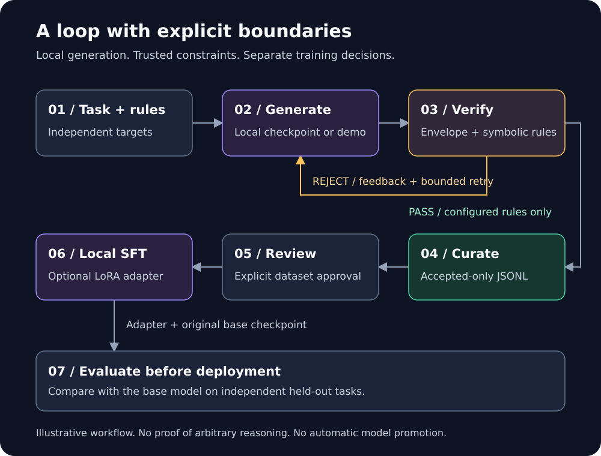

# Prism Zero

<p align="center">
  
</p>

An offline-first Python toolkit that generates candidate solutions, checks explicit
symbolic rules, retries rejected candidates, and curates accepted examples for
local LoRA supervised fine-tuning (SFT).

No hosted model API or API key is required. Model weights, dependencies, hardware,
and electricity are still your responsibility.

[Quick start](#quick-start) · [Local models](#use-a-local-model) · [Training](#train-a-local-lora-adapter) · [Verification](#what-the-verifiers-check) · [Contributing](CONTRIBUTING.md)

## What it does

| Step | Behavior |
| --- | --- |
| Generate | Use a scripted demo or a trusted local Hugging Face checkpoint. |
| Verify | Check Python syntax, JSON Schema, regex assertions, or exact rational arithmetic. |
| Retry | Return rejection feedback within a fixed attempt budget. |
| Curate | Export only candidates that pass all configured checks to deduplicated JSONL. |
| Train separately | Review the dataset, then explicitly run local PyTorch/PEFT LoRA SFT. |

This is not a reproduction of o1 or DeepSeek-R1. `<think>` tags contain a
model-generated explanation, not access to private internal computation. A correct
answer does not prove its explanation. Retrying a prompt does not update weights.

## Quick start

The demo needs Python 3.11 or newer and Git. It uses a labeled scripted generator:
no model weights, PyTorch, or API key are needed.

### 1. Get the source

```sh
git clone https://github.com/DudeSquad999/prism-zero.git
cd prism-zero
python -m venv .venv
```

On Windows, use `py -3` instead of `python` to create the environment if necessary.

### 2. Activate the environment

Linux or macOS, using bash or zsh:

```sh
source .venv/bin/activate
```

Windows PowerShell:

```powershell
.\.venv\Scripts\Activate.ps1
```

If PowerShell blocks activation, use `.\.venv\Scripts\python.exe` in place of
`python` in the commands below; changing your execution policy is not required.

### 3. Install and run

Run these from the repository root:

```sh
python -m pip install -e ".[dev]"
python examples/quickstart.py
python -m pytest -q
```

Installation normally needs network access to obtain dependencies. The scripted
demo itself does not download a model.

Expected demo behavior:

```text
Attempt 1: answer 41 is rejected.
Attempt 2: answer 42 passes verification.
The accepted example is saved to prism_zero_dataset.jsonl.
```

This is a behavior summary, not verbatim terminal output. Re-running the demo
keeps one copy of the same accepted example. It demonstrates the retry pipeline,
not a pretrained model learning to reason.

## Use the engine

This example runs from the source checkout and reuses the demo's test double:

```python
from pathlib import Path

from examples.quickstart import ScriptedModel
from prism_zero.engine import PrismZeroEngine, Rule
from prism_zero.verifiers import MathEqualityVerifier

engine = PrismZeroEngine(
    generator=ScriptedModel(),
    rules=[Rule(MathEqualityVerifier("6 * 7"))],
    dataset=Path("prism_zero_dataset.jsonl"),
    max_attempts=3,
    task_id="multiply-6-by-7",
    verifier_version="1",
)
result = engine.run("What is six times seven? Return an integer.")
assert result.accepted and result.attempts == 2
```

## How it works



Illustrative architecture, not a screenshot or benchmark. Failed checks return
feedback to generation; the retry limit ends unsuccessful runs. Passing examples
are curated, reviewed, optionally used for training, and evaluated independently.
There is no automatic adapter promotion.

## Use a local model

Install the optional ML dependencies before going offline:

```sh
python -m pip install -e ".[ml,dev]"
```

Provide a trusted compatible causal-language-model checkpoint in `models/base`,
including safetensors weights, tokenizer files, and a working chat template.
No checkpoint is bundled; review the model's license and hardware requirements.

```python
from pathlib import Path

from prism_zero.backends import LocalHFGenerator
from prism_zero.engine import PrismZeroEngine, Rule
from prism_zero.verifiers import MathEqualityVerifier

model = LocalHFGenerator("models/base", device="cpu", max_new_tokens=256)
engine = PrismZeroEngine(
    generator=model,
    rules=[Rule(MathEqualityVerifier("42"))],
    dataset=Path("prism_zero_dataset.jsonl"),
    task_id="multiply-6-by-7",
)
result = engine.run("Compute 6 * 7. Return an integer.")
print(result.accepted, result.attempts)
```

Checkpoint loading uses `local_files_only=True`, `trust_remote_code=False`, and
safetensors. Missing assets fail rather than download. Real models are not
guaranteed to produce valid output or self-correct in two attempts.

For defense in depth, set `HF_HUB_OFFLINE=1` and `HF_HUB_DISABLE_TELEMETRY=1`
before starting Python. Enforce strict network isolation at the OS/container
boundary when required; these flags are not a network sandbox.

## What the verifiers check

| Verifier | Checks | Does not establish |
| --- | --- | --- |
| `ASTVerifier` | Python parses without execution. | Runtime safety or program correctness. |
| `JSONSchemaVerifier` | Strict JSON satisfies a trusted Draft 2020-12 schema. | Factual truth; format annotations are not asserted. |
| `RegexVerifier` | A trusted pattern fully matches, with input bounds and a timeout. | Semantic correctness. |
| `MathEqualityVerifier` | Exact rational equality to an independently specified target. | Arbitrary algebra or natural-language proofs. |

JSON rejects duplicate keys, nonfinite numbers, and numeric overflow. Schema
references are disabled; trusted schemas still need complexity review. Regex
outcomes near the timeout threshold can depend on runtime load.

Math supports integers, parentheses, unary signs, and `+`, `-`, `*`, `/`.
It rejects names, calls, attributes, powers, floats, and model-supplied equalities.
It never uses `eval`.

Use `Rule(verifier, target="trace")` to check the explanation rather than the
answer. Every configured rule must pass, and at least one answer rule is required.
Backend and verifier implementation errors propagate instead of being retried as
content failures. These checks are not a sandbox or a general proof of reasoning.

## Dataset contract

Accepted records contain `schema_version`, `id`, `task_id`, `verifier_version`,
`prompt`, `trace`, `answer`, `attempts`, and `checks`. Rejected outputs are not
exported. Change `verifier_version` whenever rule semantics change.

IDs hash the task, version, prompt, and accepted content; they are not signed
attestations. Keep datasets trusted, access-controlled, and free of secrets.

Use one writer process and one store instance per path. Storage threads sharing
that instance are serialized; generator thread safety is backend-specific.
Atomic replacement prevents partially written updates, not multi-process lost
updates or every power-loss failure. The entire file is rewritten, so the store
is intended for small local collections. Invalid existing JSONL aborts an update
without replacing the existing file.

## Train a local LoRA adapter

Review and curate a meaningful dataset first. With ML dependencies installed and
the local checkpoint available, run from the repository root:

```sh
python -m prism_zero.trainer --model models/base --dataset prism_zero_dataset.jsonl --output adapters/run-001 --device cpu --epochs 1 --batch-size 1 --max-length 1024
```

The installed `prism-zero-train` command is an equivalent entry point. Use
`--device cuda` only with a compatible PyTorch/CUDA installation. LoRA reduces
trainable parameters, but the base model is loaded in full precision. Quantization,
multi-device training, and resume are not implemented. `--target-modules` accepts
`all-linear` or architecture-specific comma-separated names.

Training reuses the inference chat template. Prompt and padding labels are masked
with `-100`; position-based masking preserves genuine EOS targets. The causal
model shifts labels internally. Oversized examples and unstable assistant-token
boundaries fail instead of silently truncating answers.

The output directory must not exist. It receives an adapter, tokenizer, training
manifest, and a final `COMPLETE` marker, not a complete base checkpoint. Before
the marker is written, the saved adapter is reloaded onto a fresh copy of the
base checkpoint and one token is generated; a failed reload leaves no `COMPLETE`
marker. The manifest records library versions, dataset and checkpoint
fingerprints, effective arguments, LoRA configuration, losses, duration, and
whether reload validation ran. An exception can still leave an incomplete
directory; do not promote it.

To use a completed adapter, load the original base checkpoint and then use
`peft.PeftModel.from_pretrained` with the local adapter and `local_files_only=True`.
`LocalHFGenerator(model_path, adapter_path="adapters/run-001")` loads a local
adapter explicitly for inference and evaluation; nothing is promoted
automatically.

Training loss is not quality evaluation. Self-generated datasets can amplify
errors or overfit. Compare against the base model on independent held-out tasks;
no model-quality improvement or automatic deployment is claimed.

## Project files

| File | Purpose |
| --- | --- |
| [engine.py](prism_zero/engine.py) | Retry orchestration and accepted-only curation. |
| [verifiers.py](prism_zero/verifiers.py) | Symbolic checks and bounded arithmetic. |
| [backends.py](prism_zero/backends.py) | Local model loading and shared chat format. |
| [trainer.py](prism_zero/trainer.py) | Explicit local LoRA training. |
| [quickstart.py](examples/quickstart.py) | Reproducible scripted demo. |
| [Core tests](tests/test_core.py) | Engine and verifier regressions. |
| [Dataset tests](tests/test_dataset.py) | Shared schema and storage-failure regressions. |
| [ML tests](tests/test_ml_integration.py) | Optional tiny-checkpoint integration suite. |
| [CLI tests](tests/test_cli.py) | Command-line regressions run outside the checkout. |
| [Evaluation tests](tests/test_evaluation.py) | Metric and overlap fixtures. |
| [SVG tests](tests/test_svg_assets.py) | Artwork safety and logo-fidelity checks. |
| [Logo](assets/prism-mark.svg) | Supplied Prism mark used in the banner. |

## Command line

The installed `prism-zero` command groups the toolkit; `prism-zero-train` remains
a compatible entry point. Machine-readable JSON goes to stdout, logs go to
stderr, and exit codes separate success (0), operational failure (1), and
invalid configuration (2).

```sh
prism-zero doctor --model models/base          # PASS/WARN/FAIL environment checks
prism-zero run --config run.json               # generate, verify, retry, curate
prism-zero dataset validate data.jsonl         # shared-contract validation
prism-zero dataset inspect data.jsonl         # counts, fingerprint, review status
prism-zero evaluate --tasks tasks.json --model models/base --adapter adapters/run-001
prism-zero train --model models/base --dataset data.jsonl --output adapters/run-001
```

`run` takes a JSON configuration with `mode` (demo or local), `prompt`,
`dataset`, bounded `max_attempts`, and an allowlisted `rules` list. Verifier
names come from a fixed registry (`python_ast`, `json_schema`, `regex`,
`math_equality`); configuration never dynamically imports arbitrary Python
objects. Unknown keys, invalid types, and out-of-range values are rejected.
Relative paths in a configuration file resolve against the file's directory.
`doctor` performs lightweight checks without loading a model and refuses to
install dependencies or download assets.

## Evaluation

`prism-zero evaluate` compares four conditions on an independent task set:
base with one attempt, base within the attempt budget, and the same two
conditions with an adapter. Adapter conditions are marked NOT RUN when no
adapter is supplied, and unavailable real-model results are reported as such.
A task set is a versioned JSON file:

```json
{"task_set_version": "1",
 "tasks": [{"task_id": "arith-001", "category": "arithmetic", "prompt": "Compute 6 * 7.",
            "rules": [{"verifier": "math_equality", "expected": "42"}]}]}
```

Metrics report task counts, first-attempt and within-budget pass rates,
average attempts, invalid-envelope rate, infrastructure errors, elapsed time,
and per-category results, with explicit denominators. Candidate rejection and
infrastructure failure are counted separately. Evaluation never writes curated
records into the training dataset. When a training dataset is supplied, exact
prompt and task-id overlap is reported; exact matching does not prove the
absence of paraphrased contamination. The scripted metric fixtures in the test
suite verify the arithmetic; a real pretrained-model evaluation is separate
and must not be assumed from these tests.

## Dataset schema

Records carry `schema_version`, `id`, `task_id`, `verifier_version`, `prompt`,
`trace`, `answer`, `attempts`, and `checks`. Schema version 2 additionally
records each check's target (`answer` or `trace`) so an explanation is never
labeled verified merely because the answer passed, plus optional provenance
(`created_at`, `generator_id`, `run_id`, `review`). Version 1 records remain
readable without migration; version 2 is written by new runs. Content ids hash
the task, version, prompt, and accepted content only — no timestamps — so
identical examples stay deduplicatable across repeated runs. Repeated
observations of the same accepted content keep the first record's provenance;
the same id over different content is rejected as a conflict.

Training content is explicit: `--train-content trace-and-answer` (default,
the previous behavior) or `--train-content answer-only`, which trains on the
answer block alone. Answer-only training may cause a model to omit the think
block that the envelope parser requires; verification failures will reject
such outputs. `--require-review` refuses to train on records without recorded
human approval.

## Validation and offline setup

[VALIDATION.md](VALIDATION.md) records the bootstrap's checks and limitations.
[SVG quality review](assets/QUALITY.md) records visual checks.
[GitHub Actions](https://github.com/DudeSquad999/prism-zero/actions) shows current
CI runs; historical reports do not certify later revisions. Real-model inference,
training, and adapter reload still require separate validation.

For an airgapped system, prepare and transfer a wheelhouse, build tooling, and
model files for the same platform, Python version, and accelerator stack. Install
using `--no-index --find-links wheelhouse`. This repository does not bundle
third-party wheels or model weights.

## Contributing and license

Read [CONTRIBUTING.md](CONTRIBUTING.md) and [SECURITY.md](SECURITY.md), add negative
regressions, and report exact commands and outcomes. Never execute generated code
inside a verifier. Remove private data before sharing logs or datasets.

[MIT licensed](LICENSE). Models, datasets, and dependencies retain their own terms.
